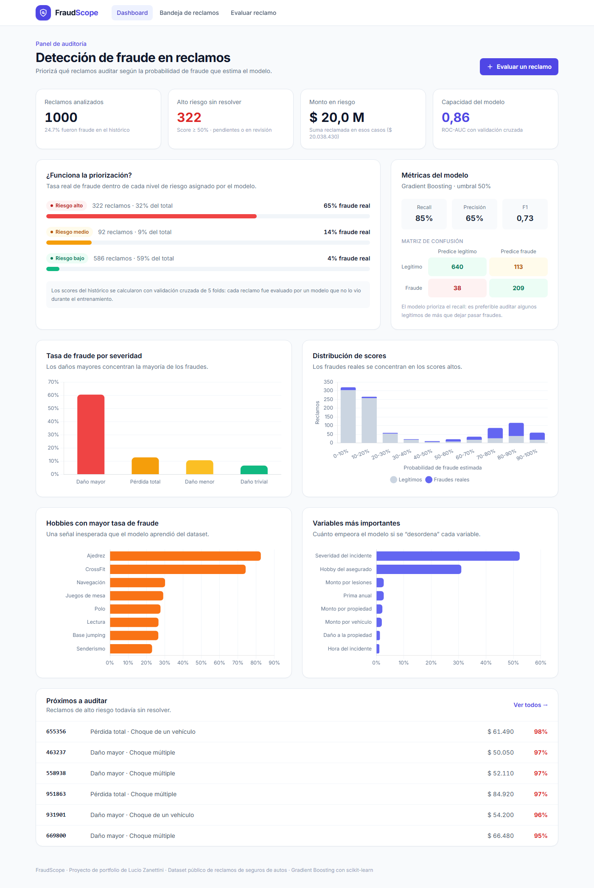
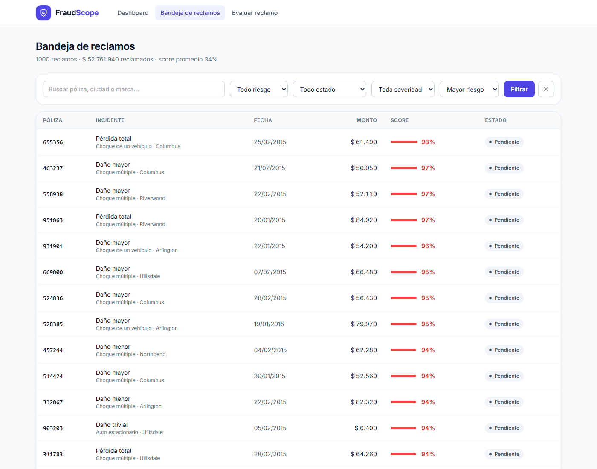
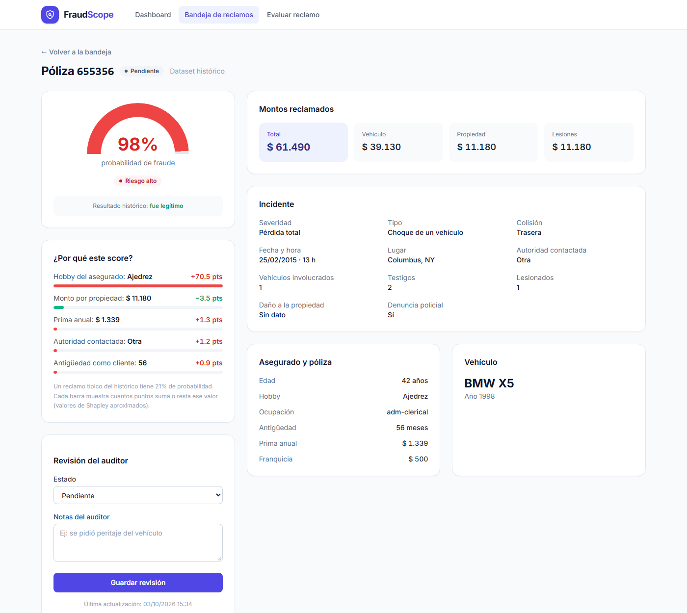

# 🛡️ FraudScope: detección de fraude en reclamos de seguros

Aplicación web en **Django** para que un equipo de auditoría **priorice qué reclamos de seguros revisar** según la probabilidad de fraude que estima un modelo de Machine Learning.

Es la evolución de mi análisis [insurance-fraud-analysis](https://github.com/Luciozanettini/insurance-fraud-analysis): el notebook se convirtió en una herramienta que se puede usar.




---

## ✨ Funcionalidades

| Pantalla | Qué hace |
|---|---|
| **Dashboard** | KPIs (reclamos de alto riesgo sin resolver, monto en riesgo), métricas del modelo, matriz de confusión y gráficos interactivos. |
| **Bandeja de reclamos** | Los 1000 reclamos ordenados por riesgo, con filtros por nivel de riesgo, estado y severidad, y búsqueda por póliza, ciudad o marca. |
| **Detalle del reclamo** | Score con medidor visual, **explicación de por qué el modelo dio ese score** y registro de la revisión del auditor (estado + notas). |
| **Evaluar reclamo** | Formulario para cargar un reclamo nuevo y obtener el score al instante, con la opción de guardarlo en la bandeja. |

<p>
  
  
</p>

---

## 🧠 El modelo

- **Algoritmo:** Gradient Boosting (`HistGradientBoostingClassifier`) dentro de un `Pipeline` de scikit-learn con One-Hot Encoding.
  Lo comparé con validación cruzada contra Random Forest y Regresión Logística, y fue el que dio mejor ROC-AUC y scores más escalonados.
- **Variables:** 18 que un analista puede cargar a mano (severidad, tipo de incidente, montos, testigos, hobby del asegurado, etc.).
- **Desbalanceo:** `class_weight="balanced"`. Se prioriza el *recall*: es preferible auditar algunos legítimos de más que dejar pasar un fraude.

| Métrica (validación cruzada, 5 folds) | Valor |
|---|---|
| ROC-AUC | **0.86** |
| Recall de fraude | 85% |
| Precisión de fraude | 65% |

**¿La priorización funciona?** Sí. La tasa real de fraude dentro de cada nivel de riesgo es:

| Nivel | Score | Reclamos | Fraude real |
|---|---|---|---|
| 🔴 Alto | ≥ 50% | 32% | **65%** |
| 🟠 Medio | 20–50% | 9% | 14% |
| 🟢 Bajo | < 20% | 59% | 4% |

Auditar solo el tercio de reclamos de riesgo alto cubre la gran mayoría de los fraudes.

### Decisiones para que los números sean honestos

- **Scores *out-of-fold*:** los scores de los 1000 reclamos históricos se calculan con validación cruzada. Cada reclamo lo evalúa un modelo que no lo vio al entrenar, así que el dashboard no muestra métricas infladas por sobreajuste.
- **Explicabilidad con valores de Shapley:** cada score se explica partiendo de un reclamo típico (21% de probabilidad). Se mide cuántos puntos suma o resta cada variable, promediando sobre 40 permutaciones aleatorias. Así el reparto es justo aunque las variables interactúen, y los aportes suman exactamente el score.
- **Faltantes como categoría:** los `?` del dataset se tratan como "Sin dato" en lugar de imputarlos con la moda, porque no tener el dato también puede ser una señal.
- **Importancia por permutación:** se mide cuánto cae el ROC-AUC al desordenar cada variable original, en lugar de la importancia por impureza, que favorece a las variables con muchas categorías.

**Hallazgo:** la severidad del incidente y el hobby del asegurado dominan el modelo. Los reclamos con *daño mayor* tienen un 60% de fraude, y los asegurados con hobbies como ajedrez o CrossFit superan el 70%. Esto último es casi seguro un artefacto del dataset (es semi-sintético) y en un caso real habría que validarlo antes de usarlo para decidir.

---

## 🚀 Cómo levantarlo en local

Requisitos: **Python 3.12+** (lo exige Django 6)

```bash
git clone https://github.com/Luciozanettini/fraudscope-django.git
cd fraudscope-django

python -m venv .venv
.venv\Scripts\activate          # Windows
# source .venv/bin/activate     # macOS / Linux

pip install -r requirements.txt

python manage.py migrate
python manage.py train_model     # entrena el modelo y guarda ml/model.joblib
python manage.py import_claims   # carga los 1000 reclamos con su score
python manage.py runserver
```

Abrí **http://localhost:8000** 🎉

Opcional: `python manage.py createsuperuser` para entrar al admin de Django en `/admin/`.

### Tests

```bash
python manage.py test claims
```

Cubren la importación, la calidad mínima del modelo (el riesgo alto debe tener mucho más fraude que el bajo), que la explicación sume el score, todas las vistas, el formulario y la revisión de un reclamo.

---

## 📁 Estructura

```
fraudscope-django/
├── claims/
│   ├── ml.py                  # Entrenamiento, predicción y explicación (Shapley)
│   ├── models.py              # Modelo Claim (datos del reclamo + score + revisión)
│   ├── views.py               # Dashboard, bandeja, detalle y evaluación
│   ├── forms.py
│   ├── labels.py              # Traducción al español de las categorías del dataset
│   ├── management/commands/   # train_model, import_claims
│   ├── templates/claims/      # Plantillas con Tailwind CSS + Chart.js
│   └── tests.py
├── data/insurance_claims.csv  # Dataset público de reclamos de seguros de autos (1000 filas)
├── docs/                      # Capturas para este README
├── fraudscope/                # Configuración del proyecto Django
└── ml/                        # Modelo entrenado (se genera, no se versiona)
```

---

## 🔭 Próximos pasos

- Login y roles (auditor / supervisor) con historial de cambios por usuario.
- Reentrenar el modelo con los fraudes confirmados por los auditores (*feedback loop*).
- API REST con Django REST Framework para integrar el score a otros sistemas.
- Deploy con Docker + PostgreSQL.
